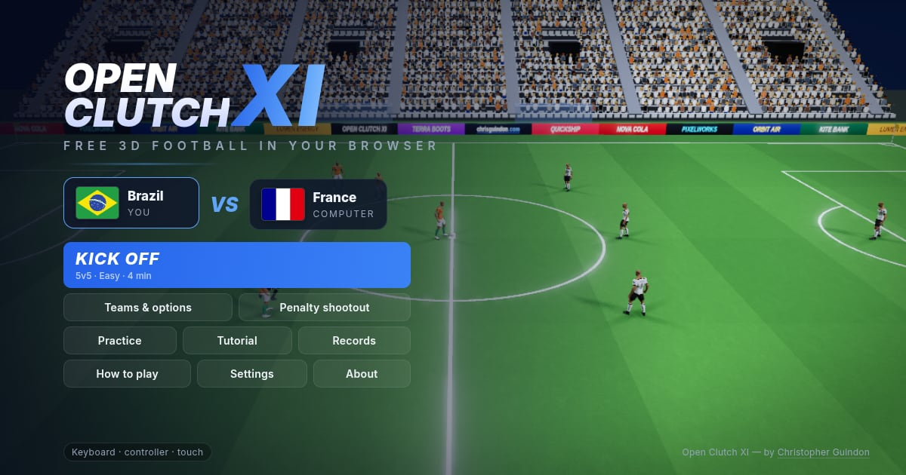

# Open Clutch XI

**A free, open-source 3D football game for the browser, built with TypeScript, Three.js and a lot of AI assistance. Play it, read it, find what's wrong with it, and help make it better.**



Source code: https://github.com/chrisguindon/open-clutch-xi · Licence: [EPL-2.0](LICENSE) · Status: in development, working towards a first release (0.1.0)

## What is Open Clutch XI?

A football game you play against the computer, in any modern browser, with no download, no account and no tracking:
- pick one of 54 national teams, as a women's, men's or mixed squad;
- play 3v3, 5v5 or 11v11;
- try the **XI Nations Cup**, a fictional tournament with groups, knockouts and a trophy;
- or take a penalty shootout, practise, or follow the tutorial.

It works with a keyboard, keyboard and mouse, a controller or a touch screen.

It is also a codebase you can learn from. It's a complete game, small enough to read: a deterministic football simulation, physics with spin and bounce, utility-based AI, skeletal animation, a rules engine based on the Laws of the Game, and plenty of tests.

## Why this project exists

Open Clutch XI started as a weekend experiment to show my nephews what you can build with AI-assisted software development. They love football games, so we set out to make our own. The name came from one of them: *open* for open source, *clutch* for the big moments, *XI* for the starting eleven.

It grew into a real game, and a practical way to explore football, 3D graphics, TypeScript and open-source collaboration. It's a personal project by [Christopher Guindon](https://www.chrisguindon.com/about/). It's not a commercial product, and not an Eclipse Foundation project.

## Built with AI assistance: what that means here

**Most of the code in this repository was written with AI coding assistants**, guided, reviewed, tested and committed by a person. We say so openly because it matters for how you read the code.

AI-assisted development can be very productive. It still needs a human to review the code, test it, debug it, make architectural judgements, and check security and licences. Expect to find:
- bugs and incomplete features;
- odd design decisions, or code an experienced developer would write differently;
- assumptions that turn out to be wrong;
- animations that don't look quite natural yet;
- places that badly need refactoring.

Not every problem is the AI's fault (people make mistakes too), and not everything here is wrong. But nothing in this repository is correct *because* an AI wrote it. Treat the code as you would any code from a new colleague: read it, question it, test it.

**That's an invitation.** Spotting what's wrong in a working codebase, explaining why, and fixing it carefully is one of the most valuable skills in software development, and this project is a friendly place to practise it. The [known issues](docs/development/known-issues.md) and [playtesting guide](docs/development/playtesting.md) list what we already know about. How the project uses AI responsibly is described in [AI-assisted workflow](docs/development/ai-assisted-workflow.md) and [ADR 0008](docs/architecture/decisions/0008-ai-assisted-contributions.md).

## Features

- **Football:** ball physics with spin (shots curl and dip), dribbling with real touches rather than a ball glued to the foot, passes, through balls, crosses, headers, shots, chips, tackles, skill moves and stamina.
- **Rules:** Standard rules for 11v11 (offside, fouls, cards, advantage, walls, every restart), and faster Arcade rules for 3v3 and 5v5. See the [rules matrix](docs/gameplay/FOOTBALL_RULES.md) for where the game simplifies the Laws.
- **AI:** team roles, utility scoring for every decision (shown live with **F3**), and four difficulty levels that change how the computer thinks, never how fast it runs.
- **XI Nations Cup:** Short (16 teams) or Classic (32), saved between matches. See [XI Nations Cup](docs/gameplay/tournament.md).
- **Presentation:** rigged and animated players, day, dusk and night lighting, a crowd of thousands, referees, replays and match statistics.
- **Records:** statistics, recent matches and achievements, kept only in your browser, with export and import.
- **Accessibility:** remappable keyboard, mouse and controller buttons, touch controls, decisions shown in words, reduced motion, and graphics that adapt to your device.

The full list is in [features in detail](docs/gameplay/features.md). Controls are in [controls](docs/gameplay/controls.md); in short, **WASD** moves, **Shift** sprints, **Space** passes, **J** shoots, and **Esc** pauses.

## Play locally

You need [Node.js](https://nodejs.org) 22 or later (24 recommended) and a browser with WebGL2.

```bash
git clone https://github.com/chrisguindon/open-clutch-xi.git
cd open-clutch-xi
npm ci
npm run dev        # then open http://localhost:5173
```

Other useful commands:

```bash
npm test           # unit, simulation and scenario tests
npm run build      # a static production build in dist/ that any web server can host
npm run lint:setup # once, before your first `npm run lint` or `npm run ci`
npm run ci         # everything the automated checks run on a pull request
```

The game is a static web app with no backend, and you don't need any account to build, test or run it. To host it yourself, see [hosting](docs/development/hosting.md).

## Learn from the code

You don't need to understand the whole codebase to learn from it or contribute to it. Good places to start:
- [**The learning guides**](docs/learning/README.md): a code tour that follows one shot from key press to saved achievement, then guides to the game loop, physics, AI, rules, rendering, saving data, and releases and hosting.
- **The exercises** ([exercises](docs/learning/exercises.md)): beginner to advanced, each with the files to read and how to test your change.
- [**Learning open source with Open Clutch XI**](docs/learning/open-source.md): how to find a bug, write a useful issue, make a branch and open your first pull request, using this game as the example.
- Press **F3** in a match to see the AI's latest decision and why it made it, then find that code in `src/sim/ai/teamBrain.ts`.

## Contributing

You're welcome here if you:
- love football and can tell when a pass, a run or a celebration looks wrong;
- enjoy games and want to see how one works inside;
- want to learn TypeScript, Three.js, Git or GitHub;
- are curious about AI-assisted development, or want to practise reviewing AI-written code;
- want to open your first issue or pull request;
- want to make games more accessible.

Things football fans can help with:
- more natural player movement and celebrations;
- better passing, shooting and goalkeeping;
- smarter AI;
- rules the game gets wrong;
- the XI Nations Cup;
- anything that makes it feel more like football.

Professional-level realism isn't the goal. Experiments are welcome.

You can write your contribution by hand or with AI tools. Both are equally welcome. Either way, you should understand it, test it and be able to explain it. [CONTRIBUTING.md](CONTRIBUTING.md) explains everything step by step. Please follow the [Code of Conduct](CODE_OF_CONDUCT.md).

### Report a bug

1. Check the [existing issues](https://github.com/chrisguindon/open-clutch-xi/issues) to see whether someone has already reported it.
2. If not, open a new issue with the **Bug report** form. Say what happened, what you expected, and how to make it happen again. Add your browser, your device and a screenshot if you can.

You don't need to know the cause. A clear description is a real contribution. Security problems are different: please report them privately (see [SECURITY.md](SECURITY.md)).

### Submit a pull request

1. Pick an issue (`good first issue` is a friendly start) or a small improvement, and say in the issue that you're working on it.
2. Fork the repository and create a branch, for example `fix/keeper-dive-direction`.
3. Make one focused change, and add or update a test where you can.
4. Run `npm run ci`.
5. Open a pull request with a title like `fix(ai): stop clearances towards our own goal`, and explain what you changed and how you tested it.
6. Discuss the review feedback and update your branch. Every pull request is reviewed by a person.

## Credits

Third-party content:
- 3D characters and animations by **Quaternius** (CC0);
- turf textures from **ambientCG** (CC0);
- recorded sounds from **Freesound** contributors (CC0);
- flags from **flag-icons** (MIT);
- the **Inter** typeface (SIL OFL);
- the **three.js** library (MIT).

Each is listed with its source in [third-party assets](docs/governance/third-party-assets.md). [NOTICE.md](NOTICE.md) holds every licence text. Teams, kits, player names and sponsors are generic or fictional: no official crests, kits or likenesses. This is a personal project, not affiliated with or endorsed by the Eclipse Foundation.

## Author

**Christopher Guindon**

- <https://twitter.com/chrisguindon>
- <https://fosstodon.org/@chrisguindon>
- <https://github.com/chrisguindon>
- <https://www.linkedin.com/in/chrisguindon/>
- <https://accounts.eclipse.org/users/cguindon>

## Copyright and license

Copyright 2026 Christopher Guindon. Code released under the [Eclipse Public License Version 2.0 (EPL-2.0)](LICENSE).

More: [documentation index](docs/README.md) · [architecture](docs/architecture/README.md) · [governance](GOVERNANCE.md) · [security](SECURITY.md) · [changelog](CHANGELOG.md).
